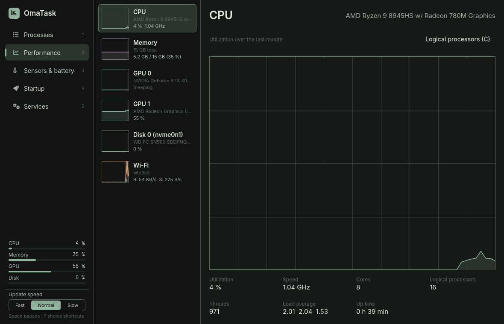

# OmaTask

A task manager for [Omarchy](https://omarchy.org), in the spirit of the Windows
Task Manager: see what uses the CPU, memory, GPUs, disks, network and battery,
end what misbehaves, and decide what starts with your session. It follows the
Omarchy theme and language live.



## Pages

| Page | What it shows |
| --- | --- |
| **Processes** | Every process grouped by app (Apps, background, system), with CPU, memory, disk and GPU use; busy values get a small load meter. A side panel shows the selected process. End, force-end, suspend, or change priority; other users' processes ask for permission through polkit. |
| **Performance** | One tile per CPU, memory, GPU, disk and network interface, and the selected one in detail below with a minute of history. The CPU can show each logical processor. |
| **Sensors & battery** | Charge, power draw, time left, battery health and cycles; every temperature and fan from `/sys/class/hwmon`. |
| **Startup** | What Hyprland starts (Lua `autostart` files and classic `exec-once`), XDG autostart entries, and user services, which can be switched on and off. |
| **Services** | systemd services, the user's or the system's, with start, stop, restart and autostart. |

A quiet line across the top shows CPU, memory, GPU, disk and network (click
one to open it on Performance) next to the update speed. The window
shrinks gracefully when tiled: chips, columns and the side panel step aside.

### Hybrid graphics

A sleeping NVIDIA GPU stays asleep. Per-process GPU use comes from the kernel's
DRM `fdinfo`, which never wakes the card, and `nvidia-smi` is only asked while
an app other than the compositor actually uses it.

## Keyboard

| Key | Action |
| --- | --- |
| `1` – `5` | Processes, Performance, Sensors, Startup, Services |
| `Ctrl+Tab`, `Ctrl+L` / `Ctrl+H` | Next or previous page |
| `/` | Search |
| `j` `k` or `↓` `↑` | Move through the list (on Performance, `h` `j` `k` `l` move between tiles) |
| `gg` / `G` | Jump to the top or the bottom |
| `Ctrl+D` / `Ctrl+U` | Half a page down or up |
| `l` `h` or `→` `←` / `Enter` | Expand or collapse an app |
| `x` or `Del` | End the selected task |
| `X` or `Shift+Del` | Force the selected task to end |
| `a` | Group processes by app, or list them all |
| `C` | Overall CPU or every logical processor |
| `S` / `R` | Start or stop, restart the selected service |
| `Space` | Pause or resume updates |
| `F5` | Update now |
| `?` / `F1` | Show every shortcut |
| `Q` | Quit |

## Build and install

```sh
git clone https://github.com/FabianJ-L/omatask.git
cd omatask
bin/install    # builds, then installs it as a package so it shows up in the launcher (Super + Space)
```

**Update:** run `oma-update`. Every Oma app (Omasql, OmaTask, Token Tally)
installs it; it updates all of them at once, from GitHub.

For development:

```sh
bin/build      # build/omatask
bin/test       # parser and model tests, offscreen
```

Needs `qt6-base`, `qt6-declarative` and `qt6-wayland`; `nvidia-utils` adds
NVIDIA utilization, memory and temperature.

## License

MIT
